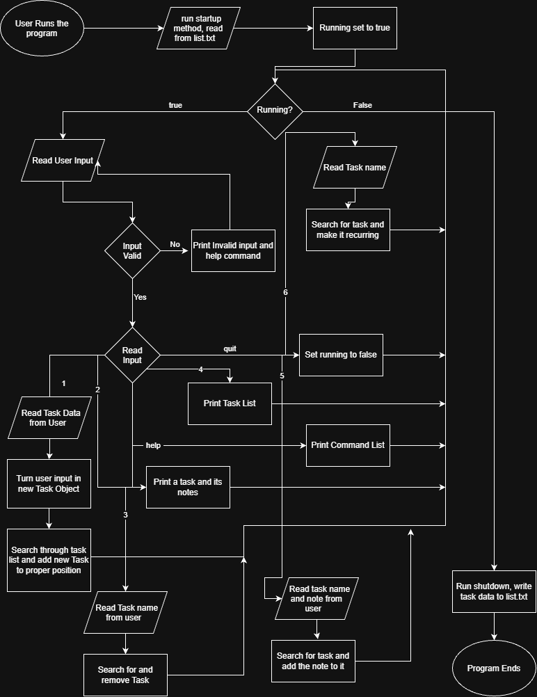

# Smarter-Task-List

This project keeps track of a list of tasks and organizes them by the due date.

## The Problem

Keeping track of assignments that need completed as well as their due dates and times, point values, etc... can get overwhelming especially when the list grows long. When it is time to sit down and work you have to sort this list and decide what to prioritize. Remembering a long list and sorting it mentally can become taxing and there is a non-zero chance of forgetting something. I repeat this remembering and sorting every day, using the same criteria to sort each time, and it cuts into my working time and can get overwhelming.

## How it Works

- Reads Task objects from list.txt
- Reads User Input
- Adds tasks to list sorted by their due date
- Prints tasks to the terminal when prompted by the user
- Prints task information when prompted by the user
- Writes task list to objects.txt

## Tech Stack
- **Language:** Java
- **Libraries:** No external libraries

## Setup
First clone the repo using: git clone  https://github.com/BChrisman23/Smarter-Task-List.git
Then move into the directory using "cd Smarter-Task-List/src"
Next, ensure that Java is Intalled: run "java -version" in the terminal
If the output is not something like: "openjdk version "25.0.5.1" 2026-11-17"
Then for Linux/Mac run:  "sudo apt install openjdk-25-jre-headless"
  for Windows run: "winget install EclipseAdoptium.Temurin.25.JDK"
Run: "java -version" to ensure that it was downloaded properly.
Finally run: "java Main.java" to begin the program
You should see:
    To add a Task to the list enter 1,Title,YYYY-MM-DD,<Optional true for weekly recurrence>
    To see a task's notes enter 2,Title
    To remove a task enter 3,Title
    To see the task list enter 4
    To add a note to a task enter 5,Title,note
    To update the list with recurring tasks enter 6
    Enter quit to exit the program and save the list
    Enter help to see the list of commands
    Enter a command:

    
## Usage
First ensure that you are in the proper directory: Smarter-Task-List/src
if not use "cd Smarter-Task-List/src"
Then use "java Main.java" to run the program.
When the program starts up it will list all of the commands you can use and prompt you for a command.
When quit is run the list of tasks are saved to List.txt and will be there when the program is run again.
For example:

    To add a Task to the list enter 1,Title,YYYY-MM-DD,<Optional true for weekly recurrence>
    To see a task's notes enter 2,Title
    To remove a task enter 3,Title
    To see the task list enter 4
    To add a note to a task enter 5,Title,note
    To update the list with recurring tasks enter 6
    Enter quit to exit the program and save the list
    Enter help to see the list of commands
    Enter a command: 4
    Task list is empty
    Enter a command: 1,CS Homework,2026-12-01
    Task added successfully
    Enter a command: 5,CS Homework,Learn Java
    note added successfully
    CS Homework, 2026-12-01
    - Learn Java
    
    Enter a command: 1,MTH Homework,2026-11-25,true
    Task added successfully
    Enter a command: help
    To add a Task to the list enter 1,Title,YYYY-MM-DD,<Optional true for weekly recurrence>
    To see a task's notes enter 2,Title
    To remove a task enter 3,Title
    To see the task list enter 4
    To add a note to a task enter 5,Title,note
    To update the list with recurring tasks enter 6
    To see this list of commands enter help
    Enter a command: 4
    MTH Homework, 2026-11-25
    CS Homework, 2026-12-01
    Enter a command: 2,CS Homework
    CS Homework, 2026-12-01
    - Learn Java
    
    Enter a command: 3,MTH Homework
    Task removed successfully
    Enter a command: quit
    Goodbye
    bre47@Firetal0n:~/Smarter-Task-List/src$ java Main.java
    To add a Task to the list enter 1,Title,YYYY-MM-DD,<Optional true for weekly recurrence>
    To see a task's notes enter 2,Title
    To remove a task enter 3,Title
    To see the task list enter 4
    To add a note to a task enter 5,Title,note
    To update the list with recurring tasks enter 6
    Enter quit to exit the program and save the list
    Enter help to see the list of commands
    Enter a command: 4
    CS Homework, 2026-12-01
    Enter a command: quit
    Goodbye

## Roadmap

- [ ] Allow User entered sorting criteria
- [ ] Basic GUI
- [X] Allow tasks to hold more data
- [X] Add recurring tasks

## Author
Brennan Chrisman, github.com/BChrisman23
