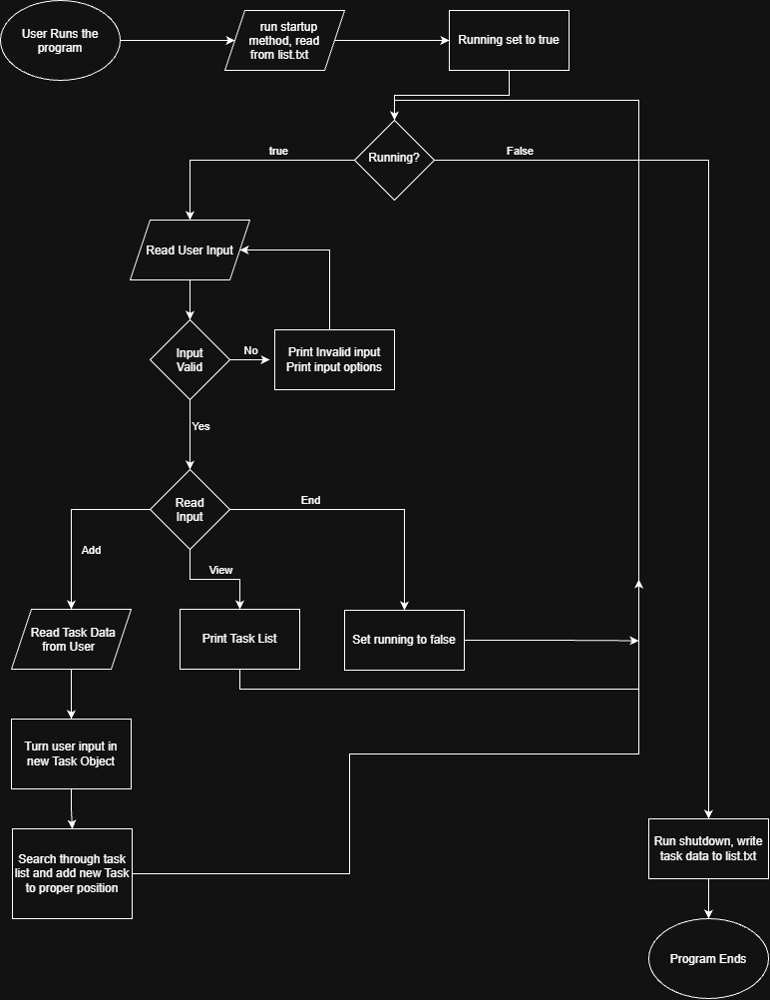

# Smarter-Task-List

This project keeps track of a list of tasks and organizes them by the due date.

## The Problem

Keeping track of assignments that need completed as well as their due dates and times, point values, etc... can get overwhelming especially when the list grows long. When it is time to sit down and work you have to sort this list and decide what to prioritize. Remembering a long list and sorting it mentally can become taxing and there is a non-zero chance of forgetting something. I repeat this remembering and sorting every day, using the same criteria to sort each time, and it cuts into my working time and can get overwhelming.

## How it Works

- Reads Task objects from list.txt
- Reads User Input
- Adds tasks to list sorted by their due date
- Prints tasks to the terminal when prompted by the user
- Prints task information when prompted by the user
- Writes task list to objects.txt

## Tech Stack
- **Language:** Java
- **Libraries:** No external libraries

## Setup

## Usage

## Roadmap

- [ ] Allow User entered sorting criteria
- [ ] Basic GUI
- [ ] Allow tasks to hold more data
- [ ] Add recurring tasks

## Author
Brennan Chrisman, github.com/BChrisman23
